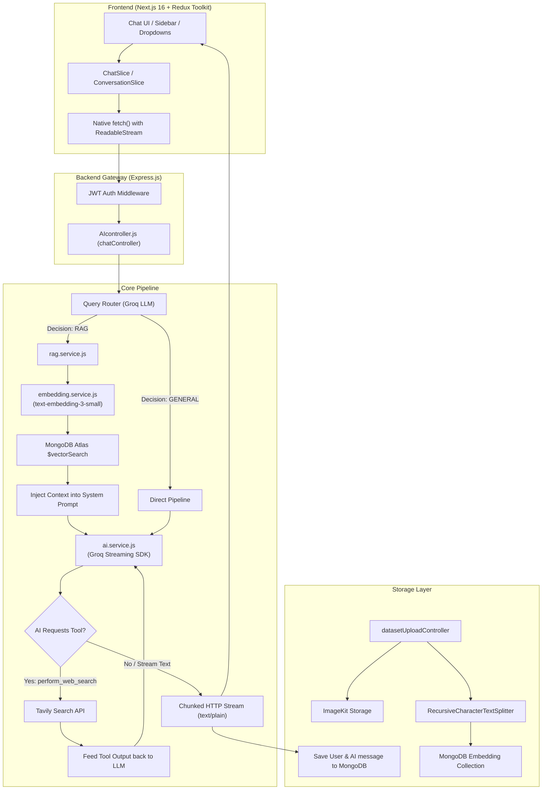
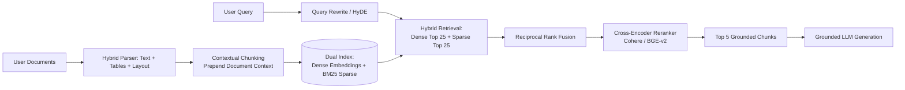
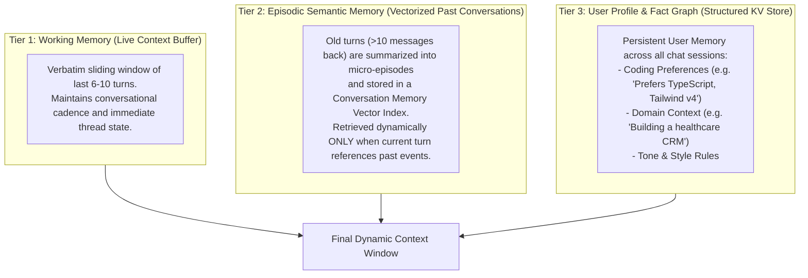
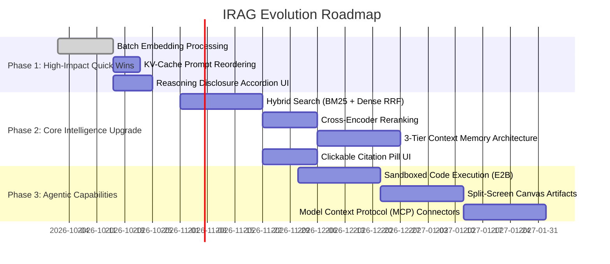

# IRAG System: Architecture Deep-Dive, Optimization & 2026 Industry-Standard Blueprint

> **Date:** October 2026  
> **System:** IRAG (Intelligent Retrieval-Augmented Generation & Agentic Chatbot)  
> **Target Audience:** Engineering, Architecture, Product, and AI System Designers  

---

## Table of Contents
1. [Executive Summary & Current Architecture](#1-executive-summary--current-architecture)
2. [End-to-End Pipeline Audit: How IRAG Currently Works](#2-end-to-end-pipeline-audit-how-irag-currently-works)
3. [Critical Bottlenecks & Architectural Debt in Current Codebase](#3-critical-bottlenecks--architectural-debt-in-current-codebase)
4. [Modern RAG Architecture (2026 Industry Standard)](#4-modern-rag-architecture-2026-industry-standard)
   - 4.1 Hybrid Search (Dense Vectors + Sparse BM25) & Reciprocal Rank Fusion (RRF)
   - 4.2 Cross-Encoder Re-Ranking (Cohere / BGE-Reranker-v2)
   - 4.3 Contextual Retrieval & Late Chunking
   - 4.4 Parent-Document & Hierarchical Retrieval
   - 4.5 Multimodal Document Parsing & Vision RAG
5. [Next-Gen Context Management & Multi-Tier Memory](#5-next-gen-context-management--multi-tier-memory)
   - 5.1 The Fallback of Simple Truncation/Summarization
   - 5.2 3-Tier Memory Architecture (Working, Semantic Episodic, User Profile)
   - 5.3 KV-Cache & Prompt Caching Optimization (90% Cost & Latency Reduction)
6. [Agentic Workflows, Tool Calling & Code Execution](#6-agentic-workflows-tool-calling--code-execution)
   - 6.1 Sandboxed Code Execution (E2B / Pyodide / Docker)
   - 6.2 Model Context Protocol (MCP) Standard
   - 6.3 Multi-Step Reasoning & Reflection Loops
7. [Production UI/UX Standards (2026 Benchmark)](#7-production-uiux-standards-2026-benchmark)
   - 7.1 Canvas & Interactive Artifacts (Split-Pane View)
   - 7.2 Inline Interactive Citations & Grounding Peeks
   - 7.3 DeepSeek / o1 / GPT-OSS Reasoning Accordions (`reasoning_content`)
   - 7.4 Message Branching & Version Trees
8. [Backend Scalability, Performance & Reliability](#8-backend-scalability-performance--reliability)
   - 8.1 Batch Embedding & Async Worker Queues
   - 8.2 Vector Database Strategy: MongoDB Vector Search vs Dedicated Engines
   - 8.3 Semantic Response Caching
   - 8.4 LLM Observability, Guardrails & Evaluation (Langfuse & Ragas)
9. [Prioritized Implementation Roadmap](#9-prioritized-implementation-roadmap)

---

## 1. Executive Summary & Current Architecture

IRAG is an end-to-end AI assistant platform built with **Next.js (React 19, Tailwind CSS v4, Redux Toolkit)** on the frontend and **Node.js (Express, MongoDB Atlas Vector Search, Groq / Clod AI APIs)** on the backend.

The platform was built to bridge conversational assistance with custom document understanding (RAG) and real-time live data via web search.

### Current High-Level Architecture Diagram



---

## 2. End-to-End Pipeline Audit: How IRAG Currently Works

### 2.1 User Request & Frontend Transport
* **State Management**: Redux Toolkit manages `messages`, `currentConversationId`, `model`, `webSearch`, and `uploadedFile`.
* **Streaming Protocol**: When the user types a prompt, `page.tsx` executes a native `fetch()` POST to `http://localhost:5000/ai/chat/:id`.
* **Chunk Decoding**: Uses `response.body.getReader()` with `TextDecoder("utf-8", { stream: true })`. Every incoming chunk dispatches `updateLastMessageContent()`, driving a live typewriter effect.
* **Markdown Rendering**: Rendered via `react-markdown` with `remark-gfm` and Prism syntax highlighting (`react-syntax-highlighter`).

### 2.2 Ingestion & Dataset Upload Pipeline
* **File Upload**: Handled via `multer` in memory buffer.
* **Storage Backup**: Automatically uploaded to **ImageKit** CDN (`imagekit.service.js`).
* **Document Parsing**: Handled in `FileParser.js`:
  - PDF: `@langchain/community/document_loaders/fs/pdf` (converts buffer to `Blob`).
  - Word: `mammoth.extractRawText()`.
  - Excel: `xlsx` (converts first sheet to CSV format).
  - CSV: `d3-dsv` CSV parser.
* **Chunking**: `RecursiveCharacterTextSplitter` configured with `chunkSize: 1000`, `chunkOverlap: 200`.
* **Embeddings**: Generated using `text-embedding-3-small` via OpenRouter/OpenAI endpoint.
* **Vector Index**: Stored in MongoDB collection `EmbeddingModel` with `{ fileId, text, embedding, metadata }`.

### 2.3 Retrieval Augmented Generation (RAG)
* **Routing**: `queryRouter.service.js` uses an LLM classification prompt to determine whether a query is `RAG` or `GENERAL`.
* **Vector Match**: If `RAG`, `rag.service.js` creates a query vector and executes a `$vectorSearch` pipeline on MongoDB:
  - `numCandidates: 50`, `limit: 3`.
  - Filtered by `fileId: { $in: conversation.files }`.
  - Hard score threshold: `chunk.score > 0.35`.
* **Context Injection**: Top 3 matching chunks are joined with `\n---\n` and injected as a system instruction before the user's latest query.

### 2.4 AI Model Execution & Web Search Tools
* **LLM Aggregator**: Connects to Groq SDK with dynamic model selection:
  - `openai/gpt-oss-120b` (Primary large model).
  - `openai/gpt-oss-20b` (Fast model).
  - `qwen/qwen3.8-27b` (High-reasoning model).
* **Tool Calling**: When `perform_web_search` is enabled, the function schema is passed into the OpenAI `tools` array. The model autonomously invokes Tavily Search API, receives web snippets, and synthesizes grounded answers.

---

## 3. Critical Bottlenecks & Architectural Debt in Current Codebase

| Component | Current Implementation | Risk / Limitation |
| :--- | :--- | :--- |
| **Document Embedding** | `for` loop with individual `await generateEmbedding(chunk)` | **Extremely slow ingestion**. A 50-page document (200 chunks) takes 2-4 minutes sequentially. Should be batch processed in parallel. |
| **Context Window / Memory** | `if (messages.length > 10) summarizeHistory()` | **Context Obliteration**. Drops all middle messages, system nuances, and instructions, replacing them with a 5-sentence paragraph. |
| **Retrieval Architecture** | Pure single-vector search with hardcoded `limit: 3` and static `0.35` threshold | **Keyword Misses & Low Recall**. Pure cosine vector search fails on exact identifiers, model numbers, dates, and names. Misses multi-part answers. |
| **Document Chunking** | Fixed 1000-character arbitrary chunks | **Loss of Context & Boundaries**. Cuts tables, sentences, and sections in half without preserving parent section hierarchy. |
| **Tool Execution** | Single-hop Tavily search | **No Code Execution / Data Analysis**. Cannot calculate, execute math, run data analysis on uploaded CSVs/Excel sheets, or graph charts. |
| **Prompt Caching** | Dynamic timestamps and changing message prefixes | **Misses KV-cache hits**. Full tokens re-billed on every single generation turn. |
| **Streaming UI** | Raw text markdown stream | **No Artifacts / Canvas / Reasoning Disclosures**. Model reasoning tokens clutter the view, code blocks cannot be tested or previewed in real-time. |

---

## 4. Modern RAG Architecture (2026 Industry Standard)

The 2026 standard for production RAG systems has moved far beyond basic vector search. Production platforms utilize a **5-stage modular pipeline**:



### 4.1 Hybrid Search (Dense Vectors + Sparse BM25) & Reciprocal Rank Fusion (RRF)
* **The Problem**: Vector search understands semantic meaning ("automobile" matches "car"), but fails on exact keyword lookups ("Error code 0x80042108", "Part #X702", dates, table column headers).
* **The Solution**: Maintain two indices:
  1. **Dense Vector Index** (MongoDB Vector Search or Qdrant/Pinecone).
  2. **Sparse Inverted Index (BM25)** (MongoDB Atlas Search or Elasticsearch/Meilisearch).
* **RRF Algorithm**:
  Combine rankings from both systems without score calibration issues using Reciprocal Rank Fusion:
  $$RRF(d) = \sum_{m \in M} \frac{1}{k + rank_m(d)}$$
  *(where $k \approx 60$, $rank_m(d)$ is the document rank in index $m$).*

### 4.2 Cross-Encoder Re-Ranking (Cohere / BGE-Reranker-v2)
* Instead of sending top 3 raw vector results directly to the LLM:
  1. Retrieve top 25 chunks using Hybrid Search.
  2. Pass `(query, chunk_text)` pairs through a **Cross-Encoder Reranker** (`cohere-rerank-v3` or local `bge-reranker-v2-m3`).
  3. The reranker computes deep cross-attention between question and passage, filtering out false positives and keeping only the top 4-5 hyper-relevant chunks.
  4. Yields a **35-50% increase in answer accuracy**.

### 4.3 Contextual Retrieval & Late Chunking (Anthropic Standard)
* When a document is split into 1000-character pieces, chunks like *"Revenue grew by 14% compared to the previous quarter"* lose all context (What year? Which company? Which subsidiary?).
* **Contextual Chunking Technique**:
  During ingestion, an ultra-fast LLM generates a 50-word situational context for each chunk:
  ```text
  [Document: Q3 2025 Tesla Financial Report, Section: Automotive Segment]
  Revenue grew by 14% compared to the previous quarter...
  ```
  Both the contextual summary and chunk are embedded together. Retrieval precision jumps dramatically.

### 4.4 Parent-Document / Hierarchical Retrieval
* **Small-to-Big Retrieval**:
  - Split text into **Child Chunks** (200 tokens) for precise vector matching.
  - Link each child chunk to its **Parent Chunk** (1200 tokens) or whole document section.
  - When the vector match hits the child chunk, feed the *parent chunk* to the LLM. The model receives complete paragraphs and intact tables rather than fragmented sentences.

### 4.5 Multimodal Parsing & Vision RAG
* Traditional PDF extraction (`pdf-parse`, `mammoth`) strips out layout, flowcharts, tables, and architecture diagrams.
* **2026 Upgrade**: Use Vision LLMs (Gemini 2.5/3 Flash or GPT-4o-mini) to transcribe PDF pages containing charts or complex layouts into clean Markdown tables and descriptive diagrams, preserving structured data.

---

## 5. Next-Gen Context Management & Multi-Tier Memory

### 5.1 The Breakdown of Simple Truncation
Current systems that truncate or compress all messages into a short summary lose:
1. Exact user instructions and technical constraints.
2. Code snippets previously shared.
3. Nuanced correction steps given 4 turns prior.

### 5.2 3-Tier Memory Architecture
Modern AI chat applications structure memory into 3 distinct tiers:



### 5.3 KV-Cache & Prompt Caching Optimization
Modern LLM inference engines (Groq, Anthropic, OpenAI, DeepSeek) implement **automatic KV-cache reuse**:
* If the prefix of your prompt matches previous requests, the provider skips computing prompt tokens and charges up to **90% less** while responding **3-5x faster**.
* **Rules to leverage KV caching**:
  1. **Fixed Prefix Order**: `[Static System Prompt] -> [RAG Context / Tools Schema] -> [User Profile] -> [Conversation History] -> [New User Prompt]`.
  2. Do **NOT** place dynamic timestamps inside the static system prompt.
  3. Keep the document context block stable throughout the active session.

---

## 6. Agentic Workflows, Tool Calling & Code Execution

Current applications that rely purely on text generation fail when asked to calculate numbers, parse datasets, or plot charts.

### 6.1 Sandboxed Code Execution (E2B / Pyodide / Micro-Containers)
* **ChatGPT Advanced Data Analysis & Claude Analysis Standard**:
  When a user uploads an Excel or CSV file and asks:
  > *"What was the month-over-month growth rate and plot a trend chart?"*
* **How It Works**:
  1. Model generates Python code using `pandas`, `numpy`, and `matplotlib`.
  2. Backend delegates code execution to a secure sandbox (such as **E2B Sandbox SDK** or isolated microVM).
  3. Sandbox executes code, returns stdout results and generated image (PNG/SVG) to backend.
  4. Frontend displays the verified calculation and interactive chart directly in chat.

### 6.2 Model Context Protocol (MCP) Standard
* Released as an open standard by Anthropic and adopted industry-wide by 2026.
* **Why it matters**: Instead of hardcoding custom APIs for Tavily, Google Drive, GitHub, and Postgres, you run or connect to **MCP Servers**:
  - `mcp-server-postgres`: Allows IRAG to safely run read-only queries on SQL databases.
  - `mcp-server-github`: Allows IRAG to read repos, pull requests, and commit logs.
  - `mcp-server-filesystem`: Secure local document workspace exploration.

### 6.3 Multi-Step Reasoning & Reflection Loops (ReAct)
Instead of a single-turn tool call:
```text
Thought: The user wants to compare two companies' financials from 2025.
Action 1: Search Document A for Company 1 revenue.
Observation 1: Company 1 revenue was $4.2B.
Thought: Now I need Company 2 revenue.
Action 2: Execute perform_web_search for Company 2 2025 earnings.
Observation 2: Company 2 revenue was $6.1B.
Thought: I have both facts. Now calculate the percentage difference.
Action 3: Run python code: ((6.1 - 4.2) / 4.2) * 100.
Observation 3: 45.23%.
Final Answer: Formulate grounded, verified response.
```

---

## 7. Production UI/UX Standards (2026 Benchmark)

A modern AI chatbot UI is no longer a simple vertical text stream. Leading products (ChatGPT Canvas, Claude Artifacts, v0) follow these core UX benchmarks:

### 7.1 Interactive Artifacts & Canvas (Split-Pane View)
* Whenever the model generates code files, HTML mockups, Markdown reports, or SVG diagrams, it should wrap them in an artifact block:
  ```xml
  <artifact identifier="auth-hook" type="application/typescript" title="useAuth Hook">
  ...code...
  </artifact>
  ```
* **Frontend Behavior**:
  - The chat splits into two columns (Chat on Left, **Artifact Canvas on Right**).
  - Code is rendered with copy, download, and live execution/preview.
  - The chat doesn't get cluttered with 300 lines of code.

### 7.2 Inline Interactive Citations & Grounding Peeks
* Instead of outputting generic text, RAG outputs should include citation references: `[Source 1, p. 3]`.
* **Frontend Behavior**:
  - Rendered as clickable pill badges: `<CitationBadge id={1} page={3} text={snippet} />`.
  - Hovering displays a tooltip preview with the original chunk and relevance score.
  - Clicking opens a document drawer displaying the highlighted section of the original PDF.

### 7.3 DeepSeek / o1 / GPT-OSS Reasoning Accordions
* Modern reasoning models output internal thought tokens (`reasoning_content` or `<thought>...</thought>`).
* **Frontend Behavior**:
  - Collapsed into an expandable header: *"Thought for 4.2 seconds"*.
  - Displays a subtle pulsing badge while the model is reasoning, smoothly switching to the main answer when generation begins.
  - Prevents raw reasoning thoughts from muddying the final deliverable.

### 7.4 Message Branching & Version Trees
* Users can click "Edit" on any past prompt.
* Redux manages a conversation tree rather than a flat list.
* Pagination controls (`< 2 / 2 >`) allow switching between different branches of thought.

---

## 8. Backend Scalability, Performance & Reliability

### 8.1 Batch Embedding & Async Worker Queues
* **Current Bottleneck**:
  ```javascript
  // Current: Sequential 1-by-1 embedding loop
  for (let i = 0; i < chunks.length; i++) {
      const embedding = await generateEmbedding(chunks[i].pageContent);
  }
  ```
* **Production Fix**:
  Embedding APIs (OpenAI, Voyage, Cohere) accept arrays of inputs (up to 2048 chunks per API call):
  ```javascript
  // 2026 Standard: Batch call (100x faster, single network roundtrip)
  const chunkTexts = chunks.map(c => c.pageContent);
  const response = await openai.embeddings.create({
      model: "text-embedding-3-small",
      input: chunkTexts, // Passes entire array at once!
  });
  const embeddings = response.data.map(d => d.embedding);
  ```

### 8.2 Vector Database Strategy
* **MongoDB Vector Search**:
  - Excellent for co-locating metadata, user records, and vectors in a single database without syncing overhead.
  - Suitable for up to 500,000 document chunks.
* **When to adopt dedicated vector engines (Qdrant / Pinecone / pgvector)**:
  - If document collections exceed 1M+ vectors.
  - If you require advanced sub-millisecond payload filtering, hybrid sparse-dense scoring, and hardware-accelerated HNSW indexing.

### 8.3 Semantic Response Caching
* For applications with repeated or similar queries, deploy a **Redis Semantic Cache**:
  - Embed incoming user queries.
  - If cosine similarity against a cached query is $> 0.96$, return the cached response immediately.
  - Result: **0ms LLM cost and 25ms response time**.

### 8.4 LLM Observability & Evaluation (Langfuse / OpenTelemetry)
* Implement **Langfuse** or **LangSmith** tracing:
  - Track cost per user per session.
  - Measure TTFT (Time to First Token) and token output speed.
  - Automated RAG evaluation (Faithfulness, Context Precision, Hallucination detection) using **Ragas** framework.

---

## 9. Prioritized Implementation Roadmap

To systematically evolve IRAG into an industry-grade system, execute the following 3-phase roadmap:



### Phase 1: High-Impact Quick Wins (Effort: Low | Impact: High)
1. **Batch Embeddings**: Change sequential loop in `embedding.service.js` to array batching (`input: [...]`). Reduces upload processing from minutes to 2 seconds.
2. **KV-Cache Structure**: Reorder prompts in `ai.service.js` to place static prompts and tools first, hitting Groq's KV cache.
3. **Reasoning Tokens UI**: Extract `reasoning_content` from stream and render inside an expandable "Thinking Process" accordion.

### Phase 2: Core Intelligence Upgrade (Effort: Medium | Impact: Very High)
1. **Hybrid RAG & Re-ranking**: Add MongoDB text search or BM25 index alongside vector search, merged via RRF and scored with Cohere/BGE reranker.
2. **Clickable Citations**: Pass chunk source metadata to frontend and render interactive citation badges.
3. **Tiered Memory System**: Replace naive 10-message truncation with a rolling sliding window and persistent user profile memory.

### Phase 3: Advanced Agentic Features (Effort: High | Impact: Revolutionary)
1. **Interactive Canvas / Artifacts**: Implement split-pane view for live HTML/code previews and document editing.
2. **Python Sandbox Execution**: Integrate E2B SDK for dynamic Excel/CSV analysis and data visualization.
3. **MCP Plugin Integration**: Enable plug-and-play tools for databases, local files, and enterprise APIs.

---
*Document produced as a technical reference blueprint for the IRAG codebase.*
